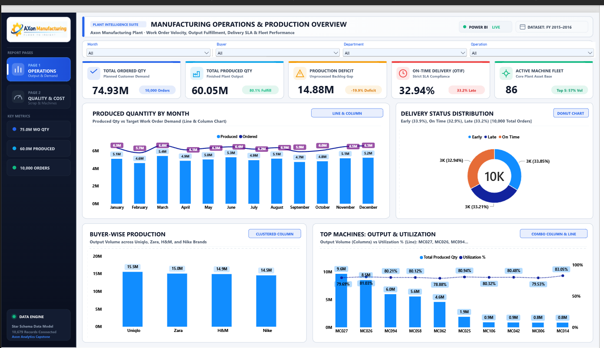
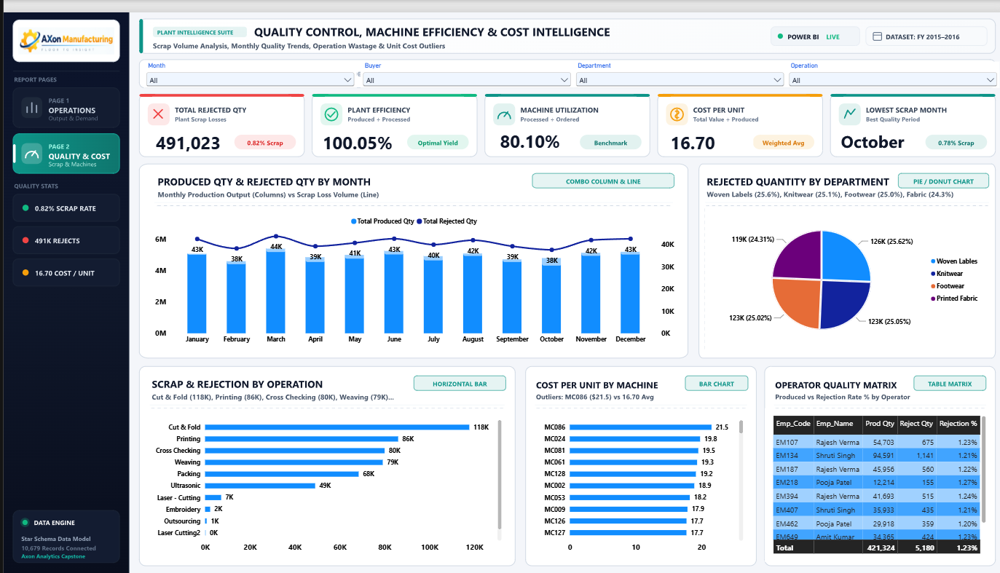
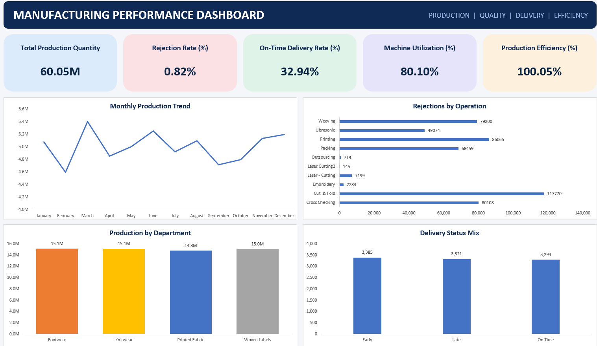
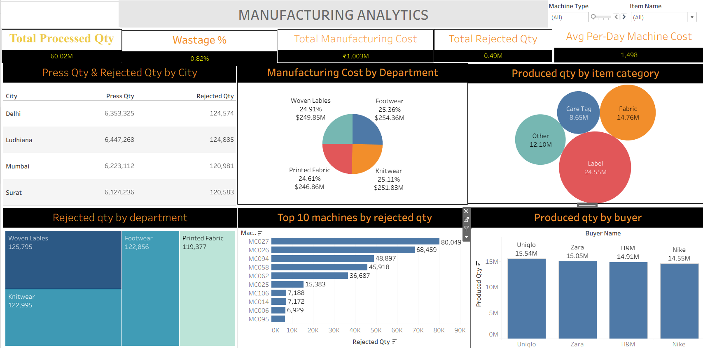

# Manufacturing Operations Analytics (Excel · SQL · Power BI · Tableau)

An end-to-end analysis of **10,000 production work orders** at Axon Manufacturing, a fictional textile and accessories plant. The orders come from **4 global brands** (Uniqlo, Zara, H&M, Nike), run on **86 machines** across **4 departments**, and cover **January–December 2015**. The goal: measure plant output, efficiency, quality, delivery and cost, and find where the plant falls short of demand.

The same KPIs are built in four tools, so the numbers can be cross-checked against each other.



---

## Headline results

| KPI | Value | Definition |
|---|---|---|
| Work orders | **10,000** | Valid orders, from 10,679 raw rows (679 blank rows removed) |
| Ordered quantity | **74.93M** units | Σ WO_Qty |
| Produced quantity | **60.05M** units | Σ Produced_Qty |
| Production deficit | **14.88M** units (19.9%) | Ordered − Produced |
| Production efficiency | **100.05%** | Produced ÷ Processed |
| Machine utilization | **80.10%** | Processed ÷ Ordered |
| Rejected units | **491,023** | Σ Rejected_Qty |
| Rejection rate | **0.82%** | Rejected ÷ Produced |
| On-time delivery | **32.94%** | On-time orders ÷ all orders |
| Total manufacturing cost | **₹1,003M** | Σ Total_Value |
| Cost per unit | **₹16.70** | Total cost ÷ Produced |
| Avg machine cost per day | **₹1,498** | Mean of Per_Day_Machine_Cost |

All rates are calculated from **totals**, not by averaging row-level percentages, so large orders carry their true weight. Every tool in this project uses the same definitions.

## Key insights

1. **Demand outruns output.** Customers ordered 74.93M units, but the plant produced 60.05M, a **14.88M-unit (19.9%) gap**. Utilization of 80.10% shows the shortfall starts before production: a fifth of ordered work is never processed.
2. **Delivery is the real weak spot, not quality.** Only **32.94%** of orders shipped on time; **33.21% were late** and 33.85% early. Rejection, by contrast, stays at **0.82%**, so the plant makes good product but can't ship it on schedule.
3. **Scrap is concentrated.** **Cut & Fold (117.8K)** and **Printing (86.1K)** are the operations with the most rejected units. By machine, **MC027 (80.0K)** and **MC026 (68.5K)** lead, making them the first candidates for maintenance.
4. **A few machines carry the plant.** The **top 5 machines produce 57%** of all output (MC027 alone 9.6M units), yet utilization is nearly flat at about 79–83% across the top 10. Output differences come from workload allocation, not machine efficiency.
5. **Departments and buyers are evenly balanced.** Each department accounts for about 25% of manufacturing cost (Footwear 25.4%, Knitwear 25.1%, Woven Labels 24.9%, Printed Fabric 24.6%), and the four buyers are close in volume (Uniqlo 15.54M, Zara 15.05M, H&M 14.91M, Nike 14.55M).

> **Data note:** efficiency is slightly above 100% because Produced_Qty exceeds Processed_Qty on many orders in the source data. It is reported as-is rather than adjusted.

---

## What's in this folder

| Folder | Contents |
|---|---|
| `data/` | All 9 tables as CSV (`fact_Production` + 8 dimensions) and `data_dictionary.txt` |
| `sql/` | `Creation.sql`: MySQL star-schema DDL, row-count checks and the `vw_production_clean` view. `KPIs.sql`: 7 KPI queries plus 3 data-integrity checks (orphan keys, duplicate work orders, negative values) |
| `excel/` | Data tables, pivot analysis and a manufacturing performance dashboard with formula-driven KPI cards |
| `powerbi/` | `.pbix`: two pages (Operations; Quality & Cost) with DAX measures, synced slicers (month, buyer, department, operation) and an operator quality matrix |
| `tableau/` | `.twbx`: 12 worksheets and one interactive dashboard (KPIs, city table, cost share, item-category bubbles, scrap treemap, top machines, buyers) |
| `presentation/` | Final project deck (PPTX) |
| `images/` | Dashboard screenshots |

## Data model

```
                    dim_Date        dim_Buyer       dim_Customer
                        │               │                │
dim_Operation ── dim_Machine ── fact_Production ──── dim_Employee
                                 │         │
                         dim_Department   dim_Item
```

- `fact_Production` holds one row per work order: quantities ordered, processed, produced and rejected, delivery status and cost.
- `dim_Machine` links to `dim_Operation` through a foreign key, so machine and operation costs stay consistent.

## Process

1. **Validate (SQL):** build the star schema in MySQL, check row counts, filter the 679 blank rows in `vw_production_clean`, and confirm 0 orphan keys, 0 duplicate work orders and 0 negative values.
2. **Calculate (SQL):** efficiency, utilization, cost per unit, monthly output, machine cost vs output, top customers, rejection rate and machine utilization.
3. **Analyse (Excel):** pivots by month, operation, department and delivery status, plus a KPI dashboard driven by formulas.
4. **Model and measure (Power BI):** star-schema model, DAX measures for every KPI, slicers synced across both pages.
5. **Explore (Tableau):** calculated fields for wastage, efficiency and cost; city, department, machine, item and buyer views.
6. **Present:** findings and recommendations deck.

## Dashboards

**Power BI: Quality & Cost**



| Excel | Tableau |
|---|---|
|  |  |

## Tools
MySQL · Excel (PivotTables, PivotCharts, formula-driven KPI cards) · Power BI (DAX, data modelling, slicers) · Tableau (calculated fields, table calculations, dashboard filters)

---

*Data: a synthetic manufacturing dataset (fictional "Axon Manufacturing") used for data analytics training at ExcelR.*
